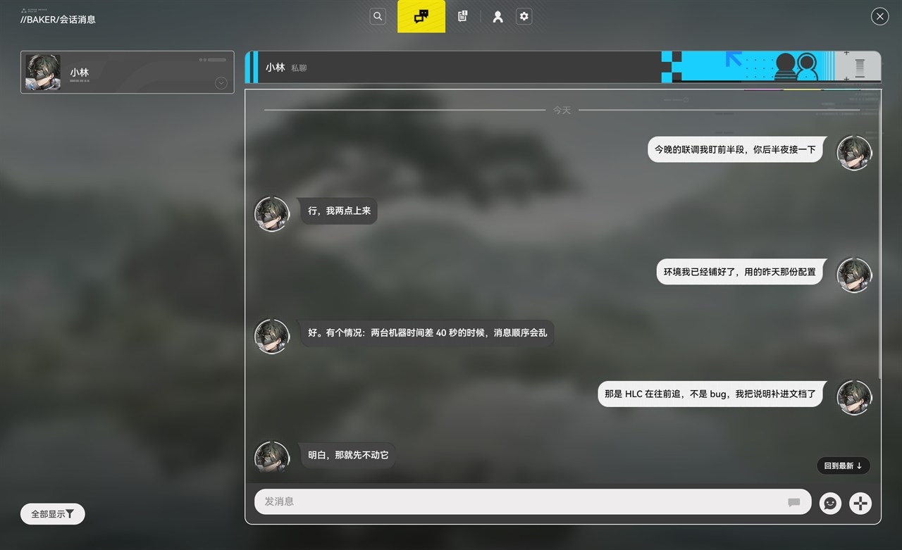

# BAKER Chat

> 一个**纯局域网**的端到端加密聊天客户端：UDP 组播发现 + TCP 直连，不经过任何服务器。
> 界面是对《明日方舟：终末地》里 Baker 界面的**个人学习性质**的复刻。
>
> **本项目是非官方的同人作品，与鹰角网络（Hypergryph）没有任何关系，未获授权、未获认可、未获赞助。**
> 仓库内**不含**任何游戏美术资源与字体，详见 [法律声明](#法律声明)。

[English](README.en.md) · [架构与加密](docs/加密与身份.md) · [网络与暴露面](docs/网络与暴露面.md) · [素材怎么补](src/assets/README.md)



---

## 这是什么

一台电脑上的消息，怎么让同一个局域网里的另一台电脑收到，而不经过任何服务器？

这仓库的做法是：

- **发现**：每 3 秒往组播组 `239.255.66.66` 播一条信标，带上自己的 id、TCP 端口和自我介绍。
- **连接**：拿到信标就直连对方的 TCP 端口，握手交换 id，之后就是一条长连接。
- **同步**：每条消息都是一个**签了名的事件**，追加进 `events.log`；所有状态（会话、好友、未读、表情）都是把事件**折叠**出来的结果。
- **加密**：Ed25519 签名身份 + X25519 协商会话密钥，正文用 AES-GCM 封起来，密钥只在外层信封里给会话成员。

没有服务器、没有公网入口、没有账号体系。两台机器在同一个 Wi-Fi 下，打开就能互相看见。

## 功能

- 单聊 / 群聊、贴纸、图片、文件、引用回复、`@` 提及、表情回应、撤回、转发到搜索
- 端到端加密，AAD 绑定「会话 + 发件人 + 收件人 + 版本 + 序号」，重放会被丢掉
- 离线补消息（差集同步）、断线重连、多设备各自持有一份完整日志
- Windows 原生通知（右下角横幅），点一下跳到那条消息
- 未读计数、置顶、免打扰、草稿、跨天分隔线、消息合并分组
- 纯键盘可用：`Enter` 发送、`Shift+Enter` 换行、`Esc` 关面板、`Ctrl/Cmd+K` 搜索

## 快速开始

需要：Node 20+、Rust 1.90+、Windows 上的 WebView2（Win11 自带）。

```bash
npm install
npm run dev            # 浏览器里看界面（没有 P2P，只是 UI）
npm run desktop:dev    # 桌面壳，真正的 P2P
```

打包：

```bash
npm run build          # 类型检查 + vite build
npm run desktop:build  # tauri build（release）
```

> **没有素材也能编译。** 头像、贴纸、字体等会被跳过，界面留空。
> 想补齐请读 [src/assets/README.md](src/assets/README.md)。

## 验证

这个仓库的自检不是摆设 —— 每一处安全相关的改动都配了**变异测试**（改坏源码，看测试会不会红）。

```bash
npm test               # 23 项：类型检查、7 个自检套件、2 条护栏、cargo check + cargo test
npm run test:mutation  # 64 条变异，每条都会改源码再逐字节还原
```

`npm test` 里包含：

- `tools/p2p-selftest.ts` —— 事件、签名、折叠、时序
- `tools/p2p-node-selftest.ts` —— 节点、限流、blob 门控
- `tools/p2p-transport-selftest.ts` —— 端到端：两台假机器真的在收发
- `tools/crypto-selftest.ts` —— 密钥协商、轮换、AAD、小阶点
- `tools/crypto-seq-selftest.ts` —— 发送序号与重放表
- `tools/chat-store-selftest.ts`、`tools/avatar-selftest.ts` —— 状态层与头像
- `tools/tauri-net-selftest.ts` —— Tauri 传输层（用替身替换 `@tauri-apps/api`）

## 目录

```
src/                  前端（React 19 + TypeScript）
  p2p/                事件、日志、折叠、HLC、节点、Tauri 桥
  crypto/             身份、密钥、信封、会话
  transport/          把 p2p 接到界面上的那一层
  store/              状态与动作
  components/         界面
  assets/             资源注册表（图片本身不带）
src-tauri/            Rust：组播发现、TCP 收发、帧路由、通知
tools/                自检、变异检查、打包脚本
docs/                 加密与身份、网络与暴露面
```

## 参与

欢迎 issue 和 PR，请看 [CONTRIBUTING.md](CONTRIBUTING.md)。
安全问题请按 [SECURITY.md](SECURITY.md) 私下报告，不要开 public issue。

## 已知问题

这些是**明确知道、暂时没修**的，写在这里省得你花时间排查：

1. **引用条（`replyTo`）的原文与 `@` 列表是明文。** 消息正文走 `cipher`，但
   `replyTo.excerpt`（被引用那条消息的原文，最多 200 字）与 `mentions` 写在事件体里，
   进 `events.log`、进每一次同步帧。修法是把它们挪进加密的 JSON 里，属于线路格式变更。
2. **事件日志明文落盘。** 加密的是正文与密钥包；谁在什么时候跟谁说了话、
   会话成员、文件名，在磁盘上是可读的。威胁模型是「同一个局域网上的别人」，
   不是「能读你磁盘的人」。
3. **时钟偏差容忍到 365 天。** 一台表错了一年的机器发一条事件，HLC 会把我们的时钟
   也拉到那个位置，之后我们发的消息都带未来时间戳。这个上限应该收窄到几分钟。
4. **跨午夜的「今天 / 昨天」标签不会自己刷新**，要等下一次渲染。
5. **只有 Windows 包。** `src-tauri/icons/icon.icns` 是占位图，macOS 需要自己补图标才能打包。

---

## 法律声明

> 以下声明同时适用于本仓库的代码、文档与发布物。**英文版见 [README.en.md](README.en.md)。**

### 1. 与游戏权利人的关系

本项目是对《明日方舟：终末地》（Arknights: Endfield，著作权人：鹰角网络 / Hypergryph）中
「BAKER」界面外观的**个人学习性质复刻**。本项目与鹰角网络及其关联公司**没有任何关系**，
**未获授权、未获认可、未获赞助、未获背书**。项目名中的 "BAKER" 指游戏内的一个界面名称，
本项目**不是**该游戏的一部分，也**不是**其官方或非官方客户端。

### 2. 本仓库不包含任何游戏素材

仓库中**没有**任何游戏美术资源、字体、音频、文本或数据文件。
所有界面素材（头像 / 表情 / 贴纸 / 图标 / 装饰 / 遮罩 / 背景）与字体
（HarmonyOS Sans SC 等）**均已从仓库中移除**，详见 [NOTICE.md](NOTICE.md)。

仓库里保留的两张图片是**自绘的 1×1 占位图**，应用图标是**自绘的中性图标**，
与游戏的美术风格无关，仅为让项目能够编译运行。

### 3. 关于「为个人学习、研究或者欣赏」

《中华人民共和国著作权法》（2020 修正）**第二十四条**第一款第（一）项规定，
「为个人学习、研究或者欣赏，使用他人已经发表的作品」可以不经著作权人许可。

**该例外仅限个人使用，不覆盖公开传播。** 因此：

- 本项目按 MIT 发布的**只有代码**，不包含任何受著作权保护的表达性素材；
- 若你自行补齐素材，**责任由你承担** —— 公开分发这些素材可能构成侵权；
- 若你把本项目部署成公开可访问的服务，界面外观本身也可能被主张权利。

### 4. 界面外观本身可能构成作品

司法实践中，游戏 UI 界面在满足独创性要求时可以构成**美术作品**受到保护。
可参考：西安市长安区人民法院（2023）陕0116知民初349号 —— 该案认定小程序的
UI 界面构成美术作品，被诉游戏界面与之构成实质性相似，判令赔偿。

这也是本项目**不随附任何界面素材**的原因：代码可以开源，别人画的界面不能。

### 5. 名称、图标与混淆

《中华人民共和国反不正当竞争法》（2025 修订，2025-10-15 施行）**第七条**规定，
经营者不得擅自使用他人有一定影响的商品名称、包装、装潢等标识，或者
「应用程序名称或者图标」等，引人误认为是他人商品或者与他人存在特定联系。

因此：

- 本项目**不使用**游戏的官方 Logo、应用图标或宣传图；
- 本项目**不得用于商业用途**，也不得用于暗示与鹰角网络的关联；
- 若你 fork 后分发，请保留本声明，并**不要**使用容易让人误认为是官方产品的名称与图标。

### 6. 侵权责任与我们的一贯做法

《中华人民共和国著作权法》（2020 修正）**第五十三条**规定，未经许可复制、发行、
通过信息网络向公众传播他人作品的，应当承担民事、行政责任，构成犯罪的追究刑事责任。

本项目作者已尽合理努力排除第三方素材。**如果你认为仓库中仍有内容侵犯了你的权利**，
请通过 issue 或邮件联系（见仓库 Insights → 贡献者邮箱），说明具体文件与权利依据，
我们会在核实后**尽快删除**，不需要你先走法律程序。

### 7. 免责

本项目按 MIT 许可「**按现状**」提供，不附带任何明示或默示的担保。
使用本项目产生的任何后果由使用者自行承担。

### 8. 致谢与出处

- 本项目最初的界面还原工作参考了开源项目 [baker-dx](https://github.com/Wanye-7300/baker-dx) 的素材整理方式；
  该仓库与本仓库均不随附任何游戏素材。
- 界面所模仿的游戏《明日方舟：终末地》及其全部美术、文字、音乐等，
  著作权归**鹰角网络（Hypergryph）**所有。
- 若权利人希望本项目停止使用某个名称或外观，请联系我们，我们会配合调整。

---

## 许可

代码与文档：[MIT](LICENSE)。第三方素材**不在**该许可范围内（本仓库不含第三方素材）。
